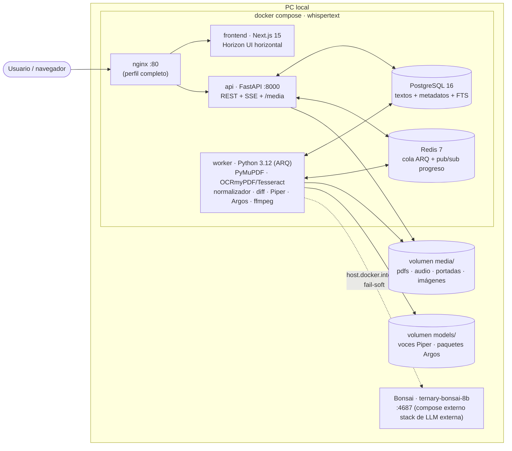
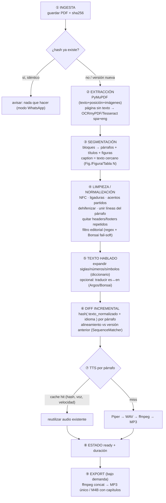

# Arquitectura general — WISPERTEXT

> **Estado: 📝 borrador**
> WISPERTEXT · Visión global del sistema: contenedores, pipeline de
> procesamiento, API, frontend y estructura de repositorio. Proyecto en
> planificación: no hay código todavía; este documento es el plano a implementar.

## Objetivo

Definir la arquitectura completa de la plataforma: cómo se transforma un PDF en
audio por párrafos con limpieza inteligente, cómo se sirve en un lector web
horizontal con resaltado, y cómo se garantiza que reemplazar un archivo solo
reprocese lo que cambió.

## Alcance

- Arquitectura de contenedores (docker compose) y servicios externos (Bonsai).
- Pipeline de procesamiento por etapas (ingesta → extracción → limpieza → diff → TTS → export).
- Contrato de API REST + SSE y layout del frontend.
- Estructura de carpetas del repo `whispertext`.
- No cubre: detalle de tablas (modelo de datos),
  justificación de decisiones (ADRs) ni
  operación (entorno Docker).

## Contenido

### 1. Principios de diseño

1. **Ligero por defecto**: modelos pequeños (Piper en CPU, sin GPU), cola que
   procesa de a un párrafo por vez, prioridad on-demand (lo que el usuario está
   por escuchar se sintetiza primero).
2. **Nada se reprocesa sin motivo**: dedup por hash de archivo, cache de audio
   por `(hash_texto, voz, velocidad)`, diff por párrafo al reemplazar versión.
3. **Bonsai es opcional y fail-soft**: toda limpieza tiene camino determinista
   (regex + reglas); Bonsai solo mejora (clasificar editorial dudoso, apoyar
   traducción). Si está apagado, el pipeline funciona igual (patrón ya usado en
   VALIDACION-DOI2BIB).
4. **Python es dueño del texto**: extracción, OCR, normalización, diff, TTS y
   export viven en el worker Python. Next.js solo presenta y consume API.
5. **Sin auth**: uso personal en PC local; ver
   seguridad.

### 2. Contenedores y servicios



- **Bonsai NO se incluye en el compose**: es un servicio existente compartido,
  consumido vía `BONSAI_BASE_URL` (default `http://host.docker.internal:4687/v1`),
  modelo `ternary-bonsai-8b`, API OpenAI-compatible.
- Perfiles: **mínimo** (api+worker fusionados, sin nginx), **estándar**
  (todos separados), **completo** (+nginx con cache de `/media`).
  Detalle en entorno Docker.

### 3. Pipeline de procesamiento (worker)



Puntos clave:

- **④ Limpieza** resuelve el problema reportado: PDFs que al extraer quedan con
  acentos separados (`cafe´` → `café`) y palabras cortadas (`infor-` + `mación` →
  `información`), que el TTS no puede leer. Reglas deterministas primero; Bonsai
  solo para clasificar párrafos dudosos como editorial (créditos, ISBN, legal).
- **⑥ Diff**: el párrafo es la unidad de cambio. Hash sobre el texto
  normalizado (no del original) para que cambios cosméticos del PDF no
  disparen audio nuevo. Alineamiento por secuencia para detectar
  añadidos/eliminados/modificados; solo los cambiados se encolan a TTS.
- **Prioridad on-demand**: la cola ARQ tiene una cola de alta prioridad; cuando
  el usuario avanza de párrafo en el lector, ese párrafo se sintetiza antes que
  el resto del lote (prefetch del siguiente).

### 4. API (FastAPI)

| Método | Ruta | Qué hace |
|---|---|---|
| POST | `/api/documents` | Sube PDF (o MD/TXT/DOCX/EPUB en fases 3-4); crea job de ingesta |
| POST | `/api/documents/{id}/replace` | Sube nueva versión del archivo → job de diff |
| GET | `/api/documents?q=&estado=` | Lista/búsqueda de biblioteca (FTS título + texto) |
| GET | `/api/documents/{id}` | Detalle + párrafos + imágenes + progreso |
| DELETE | `/api/documents/{id}` | Elimina documento + sus archivos (audio, imágenes) |
| POST | `/api/documents/{id}/reprocess` | Reprocesa con otra voz / velocidad / idioma / traducción |
| POST | `/api/documents/{id}/export` | Encola export MP3 o M4B |
| GET | `/api/documents/{id}/paragraphs` | Párrafos ordenados (texto, estado audio, imagen) |
| GET | `/api/paragraphs/{id}/audio` | Stream del MP3 con soporte `Range` |
| PATCH | `/api/documents/{id}/progress` | Guarda párrafo actual (retomar donde quedó) |
| GET | `/api/voices` | Voces disponibles (es/es_AR/en…) con la de default `es_AR-daniela-high` |
| POST | `/api/documents/{id}/cover` | Sube imagen de portada (fallback: página 1 del PDF) |
| GET | `/api/events?document_id=` | SSE: progreso de jobs en tiempo real |
| GET | `/media/**` | Archivos estáticos (audio, portadas, imágenes) |

### 5. Frontend (Next.js 15 + Horizon UI, layout horizontal)

- `/` **Biblioteca**: grid de tarjetas con portada (imagen subida → página 1 del
  PDF → solo título), título, idioma, voz, estado de procesamiento, % leído;
  búsqueda; acciones leer / reprocesar / exportar / eliminar.
- `/lector/[id]` **Lector horizontal**:
  - Columna izquierda: flujo de párrafos + imágenes en su posición; el párrafo
    en reproducción se **resalta** y la vista hace auto-scroll; click en un
    párrafo reproduce **ese** párrafo.
  - Columna derecha (fija): cada párrafo tiene su botón play a la derecha
    (audio por párrafo), y un reproductor global con play/pausa, anterior /
    siguiente, velocidad y voz.
  - **Modo enfoque** (mejora): atenúa todo excepto el párrafo activo — pensado
    para el problema de concentración.
- `/ajustes`: voz por defecto, velocidad, diccionario de siglas, watch folder.

### 6. Estructura del repo de código (planificada)

```
whispertext/
├── docker-compose.yml            # perfiles mínimo/estándar/completo
├── .env.example                  # variables sin secretos reales
├── frontend/                     # Next.js 15 + Tailwind (Horizon UI)
│   └── src/app/{page,lector/[id],ajustes}/
├── api/                          # FastAPI: rutas, schemas, dependencias, SSE
│   └── app/{routers,models,services}/
├── worker/                       # pipeline Python (ARQ)
│   ├── ingestion/                # sha256, guardado, dedup
│   ├── extraction/               # pymupdf.py, ocr.py, images.py (captions)
│   ├── cleaning/                 # normalize.py, defhyph.py, headers.py,
│   │                             # editorial_regex.py, editorial_bonsai.py
│   ├── speachable/               # siglas/números/símbolos, translate_argos.py
│   ├── diffing/                  # hash_paragraphs.py, align.py
│   ├── tts/                      # piper_adapter.py (adapter p/ Kokoro/Voicebox), export_ffmpeg.py
│   └── jobs/                     # arq worker, colas, prioridad on-demand
├── models/                       # volumen: voces Piper .onnx, paquetes Argos
├── media/                        # volumen: pdfs/, audio/, covers/, images/
└── (sin carpeta docs/ → toda la documentación vive en este vault)
```

### 7. Decisiones técnicas clave

Resumen (detalle y justificación en ADRs):

| # | Decisión |
|---|---|
| ADR-001 | TTS = **Piper** (CPU, ligero) con voz default `es_AR-daniela-high`; adapter para motores futuros |
| ADR-002 | **PostgreSQL** (no MongoDB): párrafos versionados + FTS + JSONB; audios en filesystem |
| ADR-003 | Bonsai externo existente (:4687), fail-soft, solo clasificación/traducción de apoyo |
| ADR-004 | Next.js 15 + Horizon UI (frontend) y FastAPI (API); Python dueño del pipeline |
| ADR-005 | Diff incremental por hash de párrafo normalizado + cache de audio por (hash, voz, velocidad) |
| ADR-006 | Cola Redis + ARQ (no Celery/RabbitMQ) por ligereza; SSE para progreso |
| ADR-007 | OCR = Tesseract vía OCRmyPDF (spa+eng); PyMuPDF extracción primaria |
| ADR-008 | Traducción local = Argos Translate (Bonsai opcional), sin servicios externos |
| ADR-009 | "Whisper light" = módulo STT opcional (faster-whisper base/small) para audios/videos propios |

## Ejemplos

**Reemplazo incremental (flujo típico):** subo `norma_v2.pdf` sobre el documento
`norma` (v1). El worker calcula sha256 distinto → nueva versión. Extrae y
normaliza 320 párrafos; el diff contra v1 detecta 6 modificados y 4 nuevos →
solo 10 audios nuevos; los otros 310 se reutilizan del cache por hash. El lector
muestra la v2 completa y el export se arma con los MP3 existentes + nuevos.

**Párrafo editorial saltado:** la página legal con ISBN/créditos se clasifica
`skip_reason=editorial` (regex) y no genera audio; el párrafo dudoso (prólogo
con nombres de editores) se envía a Bonsai que responde JSON
`{"editorial": true}` → se salta. Si Bonsai está apagado, queda leído (fail-soft
conservador).

## Checklist de verificación

- [x] Diagrama de contenedores y pipeline definidos.
- [x] Endpoints de API listados (a validar al implementar).
- [x] Estructura de repo planificada.
- [x] Integración con Bonsai externo especificada (fail-soft).
- [ ] Validado contra código (no hay código aún; actualizar al implementar).
- [ ] Confirmación del usuario de la arquitectura propuesta.
