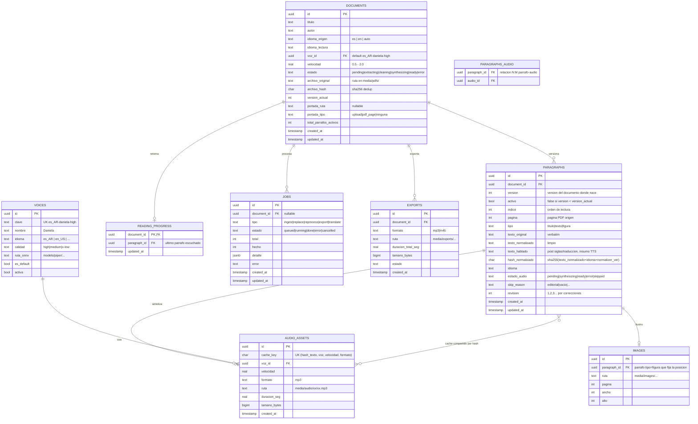

# Modelo de datos — WISPERTEXT

> **Estado: 📝 borrador**
> WISPERTEXT · Modelo entidad-relación y diccionario de datos para
> PostgreSQL 16. Los **audios NO viven en la BD**: son archivos MP3 en el
> volumen `media/` referenciados por ruta (ADR-002).

## Objetivo

Definir el esquema que soporta: biblioteca con búsqueda full-text, párrafos
versionados, cache de audio por hash (diff incremental), imágenes con caption
en posición, progreso de lectura y jobs de procesamiento.

## Alcance

Tablas, columnas clave, índices y búsqueda. Las migraciones (Alembic) se
definen al implementar. Decisiones de fondo en
ADRs 002 y 005.

## Contenido

### 1. Diagrama ER



> Nota: `PARAGRAPHS_AUDIO` es la tabla puente N:M entre párrafos y audios: el
> mismo audio (mismo hash) puede servir a varios párrafos/documentos/versiones
> — es el corazón del "no reprocesar lo que no cambió".

### 2. Diccionario de datos (reglas clave)

| Tabla | Regla |
|---|---|
| `documents` | `archivo_hash` único por `(archivo_hash, voz_id, idioma_lectura)`: subir el mismo PDF con la misma configuración → rechazo suave "ya existe" (modo WhatsApp). Subirlo con otra voz/idioma → nuevo documento o reprocess del existente (a definir en UI). |
| `documents.estado` | Máquina de estados del documento; los párrafos pueden estar `ready` antes que el documento completo (escucha temprana). |
| `paragraphs.indice` | Orden de lectura global (incluye figuras). Recalcular en cada versión. |
| `paragraphs.hash_normalizado` | Incluye `NORMALIZER_VERSION` (ADR-005): cambiar el normalizador invalida caches controladamente. |
| `paragraphs.tipo=figura` | El `texto_hablado` es el caption; `estado_audio=skipped` si la figura no tiene caption. La imagen se muestra en el lector en ese índice. |
| `audio_assets.cache_key` | UNIQUE `(hash_texto, voz_id, velocidad, formato)`. Insert-before-synth: si existe, cero llamadas a Piper. |
| `paragraphs.activo=false` | Párrafos de versiones anteriores: se conservan (historial/revertir), no se sirven al lector. |
| `reading_progress` | Una fila por documento (un solo usuario, sin auth). |
| `jobs.detalle` JSONB | Ej.: `{"diff": {"nuevos": 4, "modificados": 6, "reutilizados": 310}, "bonsai": "off"}`. |

### 3. Búsqueda full-text (biblioteca)

- `paragraphs`: columna generada `tsv` = `to_tsvector(config, coalesce(texto_normalizado, texto_original))`,
  con `config` según `idioma` (`spanish` / `english`) + índice **GIN**.
- `documents.titulo` con `pg_trgm` para búsqueda por similitud (títulos con errores de tipeo).
- Query de biblioteca: `documents MATCH título O EXISTS paragraph MATCH texto`
  → resultados con documento + párrafo destacado (para "saltar a ese párrafo",
  mejora P1).

### 4. Retención y limpieza

- Reprocesos no borran audios reutilizables (cache global por hash).
- `DELETE /api/documents/{id}`: cascada de filas + borrado físico de archivos
  propios del documento (ver seguridad).
- Limpieza opcional (P2): audios huérfanos sin ninguna asociación (job
  `gc-audio` mensual).

### 5. Categorías y formatos (v2, 2026-10-09)

```sql
-- Colecciones N:M: un documento puede estar en varias.
CREATE TABLE categories (
    id UUID PRIMARY KEY,
    nombre VARCHAR(64) UNIQUE NOT NULL,
    color VARCHAR(16) DEFAULT '#6366f1',
    icono VARCHAR(8) DEFAULT '📁',
    es_sistema BOOLEAN DEFAULT FALSE,   -- ⭐ Favoritos (sembrada, no editable)
    created_at TIMESTAMPTZ DEFAULT now()
);
CREATE TABLE document_categories (
    document_id UUID REFERENCES documents(id) ON DELETE CASCADE,
    category_id UUID REFERENCES categories(id) ON DELETE CASCADE,
    PRIMARY KEY (document_id, category_id)
);
ALTER TABLE documents ADD COLUMN IF NOT EXISTS formato VARCHAR(8) DEFAULT 'pdf';
-- pdf | txt | md | docx | html | epub
```

Reglas: borrar una categoría solo desetiqueta (los documentos quedan);
`es_sistema` no es editable ni borrable por API; el reemplazo de la lista de
categorías de un documento es completo vía `PATCH /api/documents/{id}
{category_ids}`; las tablas las crea `create_all` en el arranque.

## Ejemplos

Diff de reemplazo (v1→v2) en SQL conceptual:

```sql
-- párrafos reutilizables: hash presente en v2 y ya con audio ready en v1
SELECT p2.id, a.ruta
FROM paragraphs p2
JOIN paragraphs p1 ON p1.hash_normalizado = p2.hash_normalizado
                   AND p1.document_id = p2.document_id AND p1.version = 1
JOIN paragraphs_audio pa ON pa.paragraph_id = p1.id
JOIN audio_assets a ON a.id = pa.audio_id AND a.velocidad = 1.0
WHERE p2.version = 2;  -- → 310 filas, cero síntesis
```

## Checklist de verificación

- [x] ER completo con las 9 tablas y relaciones.
- [x] Reglas de diff/cache/dedup expresadas como constraints y claves.
- [x] FTS español/inglés definida.
- [ ] Migraciones Alembic generadas al implementar.
- [ ] Validar contra código cuando exista.
